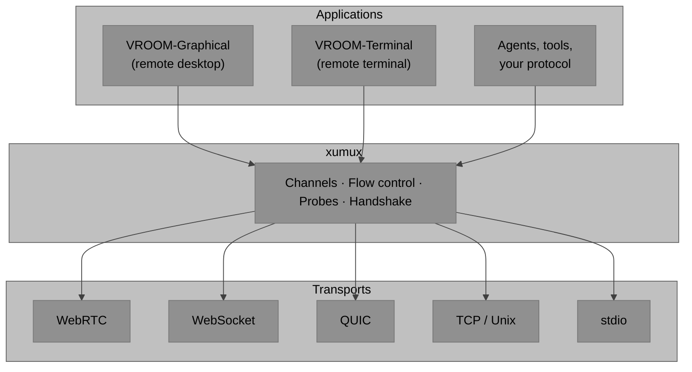

# xumux

**Channels for remote apps, over any transport.**

Version: 0.2.0-draft | Status: Draft | Date: 2026-11-07

xumux (pronounced *zuh-mux*) multiplexes named, typed channels over one connection, and each channel has its own reliability and ordering. The same 8-byte frame and the same channel model work over WebRTC, WebSocket, QUIC, TCP, Unix sockets and stdio. A browser on WebRTC and a backend on stdio can therefore talk through a bridge that never decodes the application.



## Why xumux

- **One channel model everywhere.** The same channels, flow control and close semantics, whether the transport is a DataChannel in a browser or a pipe to a child process.
- **Per-channel delivery.** A pointer channel can be unreliable and unordered while a keyboard channel is reliable, natively on WebRTC (and QUIC), and degrading cleanly on single-stream transports.
- **Per-channel quality signals.** Probe frames measure round-trip time and loss *on each channel*, so applications can adapt bitrate, switch on local echo, or fail over.
- **Bridgeable.** Frames are identical on every transport, so a bridge relays them without understanding the application.
- **Small.** One [core document](spec/core.md), one binding and the [conformance vectors](conformance/vectors.json) are enough to implement it.

xumux does not define application messages, transport setup or encryption. Those belong to the application and the transport.

## At a glance

```
[Channel:2][Type:1][Flags:1][Length:4][Payload]      flags: MORE 0x01, PROBE 0x02
```

- **Channel 0** carries control messages, which are JSON except WINDOW_UPDATE: HELLO, WELCOME, OPEN_CHANNEL, CHANNEL_ACK, CHANNEL_REJECT, CLOSE_CHANNEL, WINDOW_UPDATE, CLOSE, ERROR.
- **Channel IDs** are chosen by the opener (client odd, server even), and closing a channel takes two steps.
- **Flow control** uses per-channel credit on reliable channels.
- **PING/PONG** are probe frames on any channel. PONG echoes a 4-byte token.

## Specification

| Document | What it is |
|---|---|
| [spec/core.md](spec/core.md) | **The protocol.** Frames, handshake, channels, flow control, fragmentation, probes, codes, conformance. |
| [spec/registry.md](spec/registry.md) | Every assigned number and name. |
| [spec/bindings/](spec/bindings/) | [WebSocket](spec/bindings/websocket.md) · [TCP/Unix](spec/bindings/tcp.md) · [stdio](spec/bindings/stdio.md) · [WebRTC](spec/bindings/webrtc.md) · [QUIC](spec/bindings/quic.md) (experimental) |
| [spec/extensions/](spec/extensions/) | Negotiated changes to the core: [webrtc-multichannel/1](spec/extensions/webrtc-multichannel.md), [session-resume/1](spec/extensions/session-resume.md) (0.2 design draft) |
| [spec/profiles/](spec/profiles/) | Standard channel contents: [pipe/1](spec/profiles/pipe.md) (byte streams, port forwarding) |
| [conformance/](conformance/) | Test vectors (valid and invalid) and their generator |

### How it is layered

| Tier | Changes the core? | Stability |
|---|---|---|
| Core + bindings | is the core | Frozen at 1.0 |
| Extensions | yes, when negotiated | Versioned separately |
| Profiles | no, they define one channel's contents | Versioned separately |
| Applications | no | Their own repositories |

Tiers say who owns a document and how stable it is. For where code sits on the data path (transport, framing, session, extensions, profiles, applications), see the [I/O stack design proposal](docs/design/io-stack.md).

## Implementations and tools

| Project | Language | Status |
|---|---|---|
| [libxumux](https://github.com/deftai/libxumux) | TypeScript | Reference implementation; moving to 0.2 |
| `xumcat` | (planned) | socat-style relay: `xumcat wss://host/xumux tcp:localhost:22` |

## Application protocols

| Protocol | Description | Repository |
|---|---|---|
| **VROOM-Graphical** | Remote desktop and browser control over xumux | [deftai/vroom](https://github.com/deftai/vroom) |
| **VROOM-Terminal** | Terminal I/O (tunnel and PTY modes), successor to SocketPipe | [deftai/vroom](https://github.com/deftai/vroom) |

Application documents still in this repository are kept under [docs/apps/](docs/apps/) until they move.

## Prior art

xumux grew out of SocketPipe, a terminal-over-WebSocket protocol. It borrows deliberately from:

- **the SSH connection protocol** (RFC 4254): typed channels and windows;
- **HTTP/2 and QUIC:** IDs chosen by the opener with parity, and the stream lifecycle;
- **yamux:** credit-based flow control;
- **WebRTC DCEP** (RFC 8832): channel open with reliability parameters;
- **n.eko, Selkies-GStreamer and JetKVM:** remote-desktop control channels.

## License

MIT
