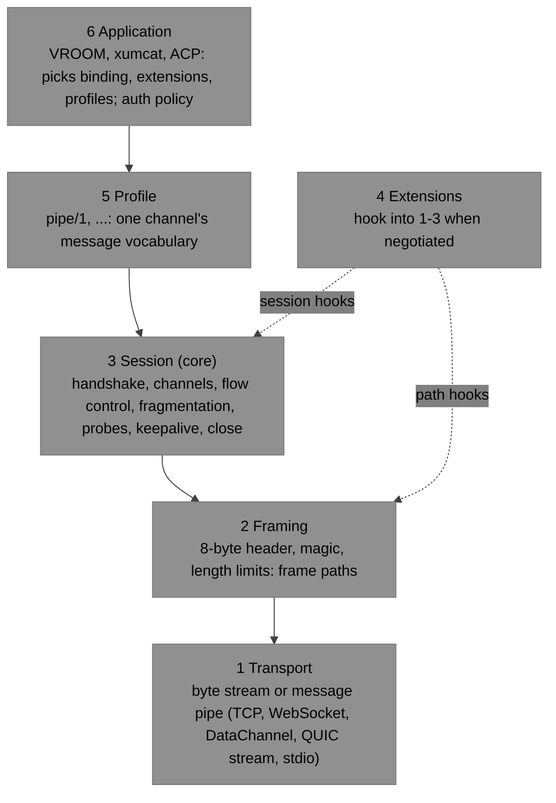

# Design: the xumux I/O stack (v0.3)

**Status**: Design draft, not for implementation | **Targets**: xumux 0.3 | **Date**: 2026-11-08

> A proposal for the v0.3 "io-stack layering" milestone. It defines the layers of an xumux implementation, what each one exposes to the next, and what each may know about the others. It then maps the current spec documents and both 0.2 implementations onto them, and lists what would change. Decisions are stated plainly. Undecided points are in [Open questions](#10-open-questions), each with a recommendation. It supersedes the 0.1-era note in deftai/xumux#2 (`docs/io-stack.md`), whose "one transport, one session, N channels" shape it keeps.

## 1. Why

The 0.2 spec is already split by document: core, bindings, extensions, profiles. But the seams between them are implicit, and the two implementations drew them in different places:

- Go ([libxumux-go](https://github.com/deftai/libxumux-go)) frames in a `FrameConn` below the `Session`.
- TypeScript ([libxumux](https://github.com/deftai/libxumux)) frames inside the session (`XumuxPeer` owns a `StreamFramer`) and keeps adapters as raw byte pipes.

Both assume one ordered frame path, and that blocks three things already in the spec or proposed: [webrtc-multichannel/1](../../spec/extensions/webrtc-multichannel.md), QUIC stream-per-channel, and [session-resume/1](../../spec/extensions/session-resume.md). Go's `effectiveProperties` and TS's `effective()` both return `reliable: true, ordered: true` for every channel. Neither can give a channel its own path, or keep a session alive while its transport is replaced. Naming the layers and their interfaces is what lets those features be added without growing the core.

## 2. The layers



| # | Layer | Gives the layer above | Specified in |
|---|---|---|---|
| 1 | Transport | a **byte stream** or a **message pipe**, already established | outside xumux (TLS, WebSocket, ICE/DTLS, QUIC) |
| 2 | Framing | **frame paths**: whole, length-checked frames | each [binding](../../spec/bindings/) + [core §2](../../spec/core.md#2-frames) |
| 3 | Session | a **session** with **channels** that carry typed messages | [core](../../spec/core.md) §3–§10 |
| 4 | Extensions | changes to layers 1–3, only when negotiated | [extensions](../../spec/extensions/) |
| 5 | Profile | a typed API for one channel (pipe/1: a byte stream with half-close) | [profiles](../../spec/profiles/) |
| 6 | Application | the product | its own repository |

**Layers and tiers are different axes.** The README's tiers (core, extensions, profiles, applications) say *who owns a document and how stable it is*. The layers say *where code sits on the data path*. Bindings belong to the core tier but sit in layers 1–2. Extensions are one tier but hook into different layers. A binding-specific extension such as webrtc-multichannel is mostly a layer-2 concern.

## 3. Interfaces

These are language-neutral shapes, not APIs. Names follow the Go implementation where it already has them.

### 3.1 Transport → Framing

One of:

- **ByteStream**: `read(buf)`, `write(bytes)` (may block: that is backpressure), `closeWrite()` (half-close, if the transport has one), `close()`.
- **MessagePipe**: `readMessage() → bytes` (binary only, a text message is an error), `writeMessage(bytes)`, `close()`.

The transport also reports its **delivery properties** (reliable, ordered) and, for message pipes, its maximum message size when known (SCTP `max-message-size`, QUIC max datagram size).

Today: Go `io.ReadWriteCloser` plus `HalfCloser`, and Go `MessageTransport`. TS `TransportAdapter` with `kind: 'stream' | 'message'`.

### 3.2 Framing → Session: frame paths

A **FramePath** carries whole frames, with the delivery guarantees its `properties` report (in order only if `ordered`):

```
readFrame(limit(channel)) → Frame      // rejects Payload Length > limit before reading it (core §2.3 step 1)
writeFrame(Frame)                      // returns when handed to the transport
closeWrite(); close()
properties → {reliable, ordered, maxFramePayload?}
```

This is exactly Go's `FrameConn`. The framing layer adds the stream-binding magic, parses lengths, and checks message length on message pipes (core §2.3 steps 1–2). The *limit* is supplied by the session, since only the session knows the negotiated `maxFramePayload`. Framing does not interpret Type or Flags. Reserved-flag checks (step 3) belong to the session, because extensions define flag bits.

A binding provides one **base path** that carries channel 0. Multi-path bindings and extensions add a **PathProvider**:

```
openPath(channelId, requested props) → (FramePath, effective props)   // opener side
acceptPath() → (channelId, FramePath)                                  // peer created one
pathClosed(channelId)                                                  // ID may be reused only after this
```

The base binding of every 0.2 document has no PathProvider. [webrtc-multichannel/1](../../spec/extensions/webrtc-multichannel.md) is a PathProvider whose paths are DataChannels labelled `xumux/<id>`, and the proposed `quic-multistream/1` is one whose paths are QUIC streams or the datagram flow. The session's rules for multi-path ([core §5.2](../../spec/core.md#52-opening-a-channel) holding, ID reuse after `pathClosed`) then live in one place, not in each extension.

**Effective properties come from the path.** This replaces the hard-coded `reliable: true, ordered: true` in both implementations. A channel on the base path gets the base path's properties.

### 3.3 Session → Profiles and applications

```
Session:  openChannel(spec) → Channel | refusal
          acceptor(request) → accept(handler) | refuse(code)     // decides on peer-opened channels
          close(code, reason); ping(); stats(); remoteLimits()
Channel:  id, name, metadata, properties
          send(type, payload)          // waits for credit; fragments as needed
          receive() → (type, payload)  // whole messages
          consume(n) / manual credit   // see below
          ping(); stats(); close(code, reason)
```

- Channels carry **typed messages**: the frame Type (application-defined on channels ≠ 0) and the reassembled payload. Fragmentation and flow control are invisible to the layer above, except through backpressure.
- **Credit release is part of the interface.** Core §6 returns credit when "the application has taken" a message, but a profile can need a later point. `pipe/1` returns credit only once bytes are written to the local end. Go exposes `SetManualCredit` / `ReturnCredit`, and `pipe.Conn.WriteTo` uses them. The interface needs a way for the layer above to say when bytes are consumed.
- **Acceptor dispatch by profile.** Peer-opened channels name their profile in `metadata.profile` ([core §11.3](../../spec/core.md#113-profiles)). A session-level acceptor that routes by profile (Go: `pipe.Listener.Acceptor()`, `ChannelListener`) is the seam between layers 3 and 5.
- **Auth is passed through.** The session hands HELLO `auth` (and the transport's identity, if any) to the application's acceptor. It does not validate it.

### 3.4 Extension hooks

An extension may use only these hooks. It may offer fields in HELLO/WELCOME, and prepare paths before acceptance where its specification permits (webrtc-multichannel creates DataChannels before HELLO), but its behaviour takes effect only once it has been negotiated:

| Hook | Layer | Used by |
|---|---|---|
| Add control types `0x30`–`0x7F` and handle them | 3 | session-resume (RESUME_TOKEN, RECEIPT, …) |
| Add fields to HELLO, WELCOME, ChannelRequest, ChannelAccept | 3 | webrtc-multichannel (`dataChannel`), quic-multistream (`quic`) |
| Define reserved flag bits | 2–3 | none yet |
| Provide a PathProvider (and per-path effective properties) | 2 | webrtc-multichannel, quic-multistream |
| Change the scope of flow control for some channels | 3 | quic-multistream (QUIC flow control on dedicated streams) |
| Replace the base path under a live session | 2–3 | session-resume |
| Define another first frame on a new transport | 2–3 | session-resume (RESUME instead of HELLO) |
| Codes `4100`–`4499` | 3 | session-resume (4100–4103) |

An extension that needs anything outside this list is a core change.

### 3.5 Profile → Application

Profile-specific, in the host language's idiom: `pipe/1` is a `net.Conn` in Go (`pipe.Conn`, which passes `nettest.TestConn`), and would be a `Duplex` or a `ReadableStream`/`WritableStream` pair in TS.

## 4. Who may know what

| Layer | May know | Must not know or depend on |
|---|---|---|
| 1 Transport | its own setup, encryption, peer identity | frames, channels |
| 2 Framing | header layout, magic, the limit it is given, its path's properties | channel state, control messages, Type and Flags meanings, application payloads |
| 3 Session | everything in core; path properties; the extension hooks; channel `name` and `metadata` as opaque values | the transport kind (only its path properties), profile vocabularies, payload contents on channels ≠ 0, the meaning of `auth` |
| 4 Extension | the layers it hooks, as listed in §3.4 | profiles, applications |
| 5 Profile | the Channel interface: types, payloads, metadata, properties, credit release | channel 0, other channels, the binding, flags, fragmentation |
| 6 Application | the session API, profiles, its own `application` string, and auth policy | frame layout |

Two rules carry most of the weight:

1. **The session never asks what transport it is on.** It sees only path properties. That is what lets one session implementation run on every binding and lets a bridge swap transports.
2. **A profile never touches channel 0.** Everything a profile needs (open, refuse with a code, close with a code, metadata) goes through the Channel interface, so profiles never need core changes ([core §11.3](../../spec/core.md#113-profiles)). The 0.1-era `session-persistence` text broke this rule by putting DETACH and ATTACH on channel 0, and is why it is moving to VROOM.

## 5. Placement decisions

| Concern | Layer | Why |
|---|---|---|
| Magic bytes | 2 | per binding. Stream bindings send it; QUIC, WebSocket and WebRTC do not |
| Frame length limit (core §2.3 step 1) | 2, with the limit from 3 | must reject before buffering the payload |
| Reserved flags, `MORE` on channel 0, channel `0xFFFF` (step 3) | 3 | flag meanings are extensible |
| Fragmentation and reassembly | 3 | depends on negotiated limits, effective properties and remaining credit (fragment to fit credit), none of which framing knows. Both implementations already do it in the session. (deftai/xumux#2 put it in the framer.) |
| Flow control | 3 (or the path, where an extension says so) | per channel; quic-multistream delegates to QUIC |
| Probes and keepalive | 3 | per channel, and keepalive needs "any frame received" across all paths |
| Fair scheduling between channels on one path | 3 | it needs to see all channels' queues |
| Encryption, transport auth | 1 | out of xumux |
| HELLO `auth` validation | 6 | format is application-defined |
| Session persistence, scrollback, attach | 6 | out of xumux |

## 6. Mapping the current documents

| Document | Layer(s) | Notes |
|---|---|---|
| [core.md](../../spec/core.md) §2 | 2 | frame header, validation steps 1–2 |
| core.md §3–§10 | 3 | |
| core.md §11 | 3–4 | extension, binding and profile rules |
| [bindings/tcp](../../spec/bindings/tcp.md), [stdio](../../spec/bindings/stdio.md) | 1–2 | ByteStream; one base path with magic |
| [bindings/websocket](../../spec/bindings/websocket.md), [webrtc](../../spec/bindings/webrtc.md) | 1–2 | MessagePipe; one base path |
| [bindings/quic](../../spec/bindings/quic.md) | 1–2 | *As proposed in deftai/xumux#8:* ByteStream (one session stream), no magic. The document on `main` is still the 0.1-era stream-per-channel draft |
| [extensions/webrtc-multichannel](../../spec/extensions/webrtc-multichannel.md) | 2 (+3 fields) | PathProvider over DataChannels |
| quic-multistream (proposed) | 2 (+3 fields, flow-control scope) | PathProvider over streams and datagrams |
| [extensions/session-resume](../../spec/extensions/session-resume.md) | 2–3 | replaces the base path under a live session. It needs channel states and properties, so it is not a pure path wrapper |
| [profiles/pipe](../../spec/profiles/pipe.md) | 5 | needs reliable+ordered and credit release on write |
| [docs/apps/*](../apps/) | 6 | moving out of this repository |

## 7. Mapping the implementations

| Layer | libxumux-go | libxumux (TS) |
|---|---|---|
| 1 | `io.ReadWriteCloser` + `HalfCloser`; `MessageTransport`. xumcat's `transport` package dials and serves the bindings | `TransportAdapter` (`kind`, `magic`): `TcpAdapter`, `StdioAdapter`, `WebSocketAdapter`, `WebRTCAdapter`, `QuicAdapter` (one stream), in-memory pair |
| 2 | `FrameConn`, from `NewStreamConn` (magic, framing) and `NewMessageConn` | `StreamFramer`, `decodeFrame` / `validateFrame`, **owned by `XumuxPeer`** |
| 3 | `Session`, `Channel`, `Options` | `XumuxPeer` / `XumuxClient` / `XumuxServer`, `XumuxChannel` |
| 3→5 seam | `Acceptor`, `Handler`, `ChannelListener`, `SetManualCredit` / `ReturnCredit` | `ChannelPolicy`, `ChannelDecision`. No manual credit |
| 4 | none: `extensions` is a string list, checked as a subset | none: `protected effective()` is the only override point |
| 5 | package `pipe` (`pipe.Conn`, `pipe.Listener`, `Dial`) | none (no pipe/1) |
| 6 | xumcat (`endpoint` allow-lists, relay) | VROOM (planned) |

Both implementations agree on layers 3 and 5. The differences are where framing lives and whether there is a profile layer at all.

## 8. What would change

### 8.1 Spec text (v0.3)

1. **core §1:** add a short "Layers" subsection (the table in §2 and the two rules in §4), and the terms *frame path* and *base path*.
2. **core §5.3:** effective properties are those of the channel's path, and a binding or extension defines the paths.
3. **core §11.2 Bindings:** a checklist each binding document must answer: transport kind (stream or messages); identification (magic, subprotocol, ALPN); framing; the base path's properties; how transport close and errors map to xumux codes; keepalive interplay; security.
4. **core §11.1 Extensions:** the hook list of §3.4, as the definition of what an extension may change. Also, whether extensions get a parameter slot in HELLO/WELCOME ([Open question 4](#10-open-questions)).
5. **core §11.3 Profiles:** a profile document states its required properties, whether it needs credit release later than "message taken" (pipe/1 does), and its codes.
6. **core §3.1** *(behaviour change)*: allow an extension to define another first frame on a new transport (needed by session-resume).
7. **Bindings:** each gets a one-line "Provides:" header (for example "one ByteStream base path, magic `XMUX`").
8. **README:** extend "How it is layered" with the layer column, and link this design.
9. **Conformance:** split vectors into framing (layer 2: bytes ↔ frames, limits) and session behaviour (layer 3: scripted exchanges). That matches the behavioural-conformance work planned for v0.4.

Items 1–5 and 7–9 are editorial: they describe what 0.2 already does and change no wire behaviour. Item 6, and the `extensionParams` slot of [Open question 4](#10-open-questions), change what a conforming peer may send, so they belong to a release with a version bump. As decided under [Open question 3](#10-open-questions), the editorial items also go into 0.3 rather than 0.2.x.

### 8.2 libxumux-go

- Add the PathProvider seam. Effective properties come from the path, not `effectiveProperties()`. Run a read loop per path. For paths flow-controlled by the transport, stop reading when the channel's buffer is full.
- An extension registry: control-type handlers, request/accept field hooks, flag bits.
- A way to swap the base `FrameConn` under a live `Session` (for session-resume).
- Mostly additive: the `FrameConn`, `Session`, `Channel` and `pipe` APIs stay.

### 8.3 libxumux (TS)

- Move framing out of `XumuxPeer` into a FramePath that wraps a `TransportAdapter` (the Go `FrameConn` shape). Today the session would have to own one `StreamFramer` per path to support multi-path.
- Replace `protected effective()` with path properties. Add the extension registry.
- Add manual credit release on `XumuxChannel`, which pipe/1 needs, and then a pipe/1 profile module.
- `QuicAdapter` stays as the base QUIC binding. quic-multistream would be a PathProvider next to it.

## 9. Bridges and relays

A **frame relay** forwards frames between two transports without running a session (for example WebRTC ↔ WebSocket, or the planned v0.4 cat tool's relay mode). In these terms it sits at layer 2 on both sides. It works only while both sides have the same path shape (one base path each), because flow control, holding and ID reuse are end to end. Anything that changes the shape (one side multi-path, or QUIC dedicated streams with QUIC-only flow control) needs a **session bridge**: two layer-3 sessions with channels joined at layer 5. The webrtc-multichannel "Bridging" section already implies this. This design makes it explicit.

## 10. Open questions

1. **How normative.** Should the interfaces in §3 be normative, or only the layer boundaries and the rules in §4? *Recommendation:* make the boundaries, the terms (frame path, base path) and the extension hook list normative in core §1 and §11. Keep the API shapes informative in this document, since language idioms differ.
2. **PathProvider in the core or only in extensions.** Core §5.2 already has multi-path rules (holding frames that overtake the ACK). Defining "paths" in the core would let both multi-path extensions share one set of rules for opening, binding and ID reuse. *Recommendation:* define the concept and the shared rules in the core, and leave concrete paths to bindings and extensions.
3. **Version number.** The editorial part of §8.1 changes no wire behaviour. Under [core §3.5](../../spec/core.md#35-version-negotiation), 0.2 and 0.3 cannot talk, so bumping the minor for a layering rewrite alone would break interop for nothing. The draft recommended publishing the editorial items as 0.2.x. **Decided (2026-11-08):** the layering text goes into 0.3, together with the behaviour changes (the core §3.1 first-frame rule, extension parameters) and whatever first needs them (session-resume/1), so 0.3 is one coherent revision.
4. **Extension parameters.** HELLO and WELCOME `extensions` are plain strings, so an extension with parameters needs its own message (session-resume's RESUME_TOKEN) or new top-level fields. *Recommendation:* add an optional `extensionParams` object keyed by extension name to HELLO and WELCOME, ignored unless that extension is accepted. This is a wire change, so it goes with the 0.3 bump in question 3.
5. **Reserved-flag checks in framing or the session.** This draft puts core §2.3 step 3 in the session, so framing is extension-agnostic. Go and TS both check it in their frame codec today (`frame.go`, `decode-frame.ts`). *Recommendation:* the session, with the decoder free to pre-check when no extension defines flags.
6. **Credit release in the interface.** Should "consume later than take" be a core concept (core §6 "consumed" redefined as "released by the layer above"), or an implementation detail? *Recommendation:* a sentence in core §6 that the point of consumption MAY be set by the profile, with pipe/1 as the example. It already depends on it.
7. **Frame relays.** Should the spec define a frame relay at all (§9), and which rules it must keep (limits declared end to end, no rewriting)? *Recommendation:* defer to the v0.4 cat-tool work, but state the "same path shape" rule now.
8. **deftai/xumux#2.** That draft PR (`docs/io-stack.md`, 0.1-era: `OMUX`, `FRAGMENT` flags, framer-owned fragmentation) overlaps this one. **Decided (2026-11-08):** closed in favour of this design. Its useful parts (attach-first transports, keep the mux hot path thin) were carried over. Attach-first is implied by layer 1 being "already established".
