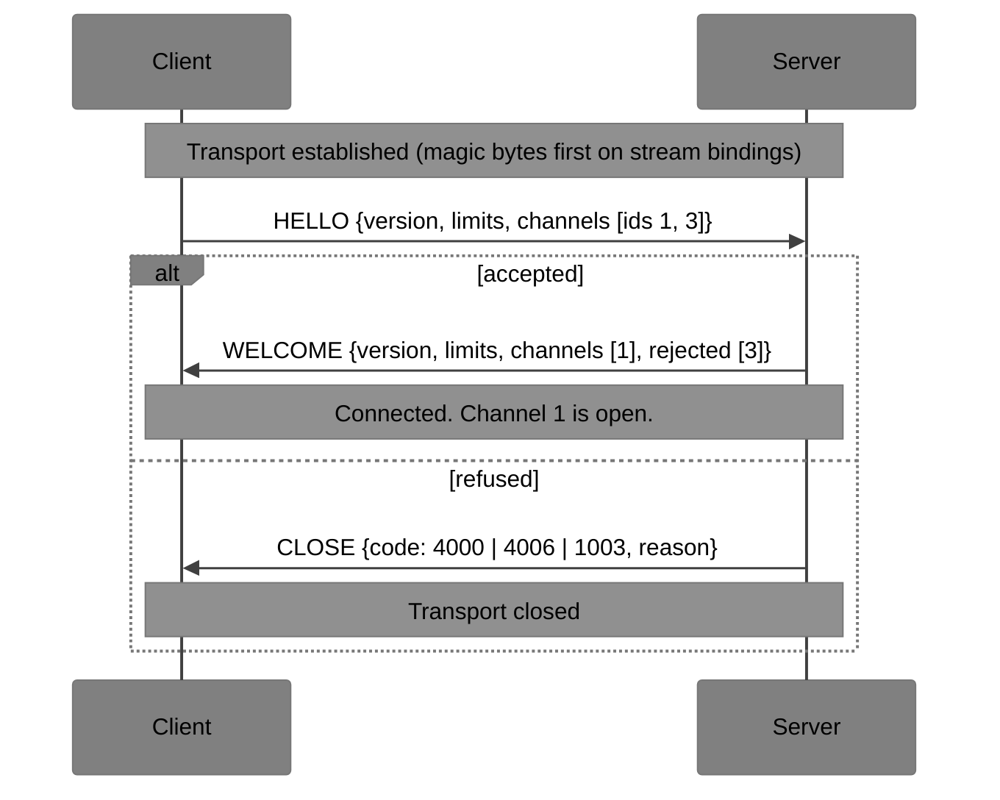
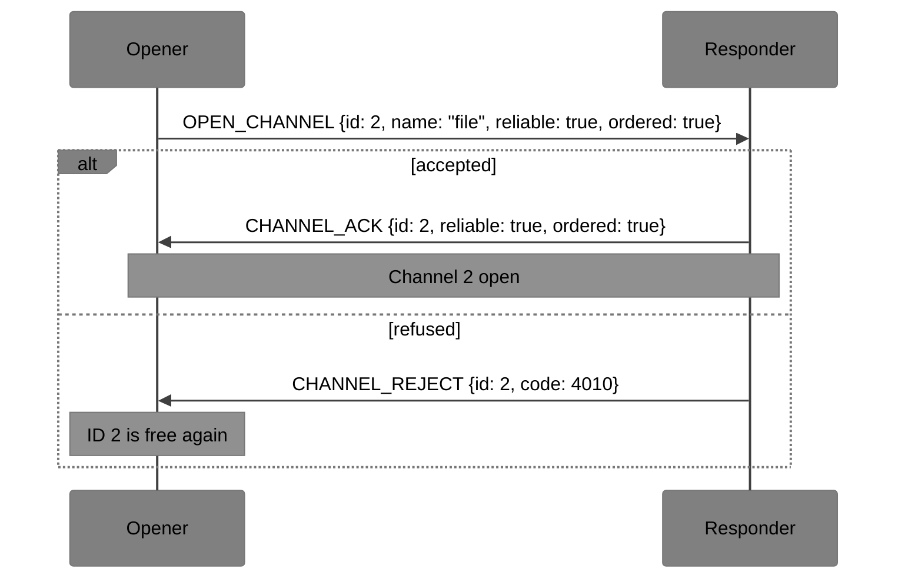
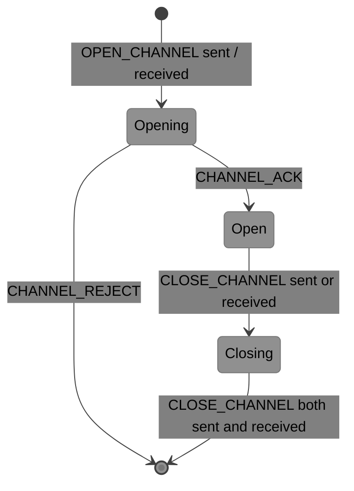

# xumux Core Specification

Version: **0.3.0-draft** | Status: Draft | Date: 2026-11-08

The key words MUST, MUST NOT, SHOULD, SHOULD NOT and MAY are used as described in RFC 2119.

This document is the whole of the core protocol. Together with one [binding](bindings/) and the [conformance vectors](../conformance/vectors.json), it should be enough to write an interoperable implementation. Numbers assigned by this document are collected in the [registry](registry.md).

---

## 1. Model

An xumux **connection** runs over one already-established **transport** (a WebSocket, a TCP socket, a stdio pair, a WebRTC DataChannel, …). Establishing, encrypting and authenticating the transport is outside xumux. The [binding](#112-bindings) turns the transport into a **base path** for frames ([§1.2](#12-layers)). An extension may add further paths, or let a connection continue on a new transport ([§3.1](#31-rules)).

The two ends are the **client** (the side that sends HELLO) and the **server**.

A connection carries **channels**. Each channel has:

- a numeric **ID** (2 bytes) carried in every frame,
- a **name** (a label for applications; not required to be unique),
- delivery **properties** (`reliable`, `ordered`, …),
- optional **metadata** for the application.

Channel 0 is the **control channel**. It always exists and carries the messages defined in this document. Every other channel carries application messages that xumux does not interpret.

### 1.1 Implementation principle

> An implementation MUST correctly handle everything a conforming peer may send. What it chooses to *send* is up to it.

For example, an implementation is not required to open channels, send PINGs or fragment small messages, but it MUST answer a PING, process a peer's OPEN_CHANNEL (even if only to reject it), and reassemble fragments. There is a single conformance level; see [§12](#12-conformance).

### 1.2 Layers

Every rule in this specification belongs to one layer, and each layer gives the one above it a defined service:

| # | Layer | Gives the layer above | Specified in |
|---|---|---|---|
| 1 | Transport | an established **byte stream** or **message pipe**, with its delivery properties | outside xumux (TLS, WebSocket, ICE/DTLS, QUIC) |
| 2 | Framing | **frame paths**: whole, length-checked frames | each [binding](bindings/), and [§2](#2-frames) |
| 3 | Session | a connection with **channels** that carry typed messages | [§3](#3-handshake)–[§10](#10-codes) |
| 4 | Extensions | changes to layers 1–3, only when negotiated, and only through the hooks of [§11.1](#111-extensions) | [extensions/](extensions/) |
| 5 | Profiles | one channel's message vocabulary | [§11.3](#113-profiles), [profiles/](profiles/) |
| 6 | Application | the product: chooses binding, extensions and profiles; validates `auth` | outside this repository |

Layers say where a rule sits on the data path. They are a different axis from the tiers in the [README](../README.md) (core, extensions, profiles, applications), which say who owns a document and how stable it is. A binding is part of the core tier but sits in layers 1–2. This specification does not require an implementation to be structured in layers. The layers fix which document may change which rule. Interfaces between the layers are sketched, informatively, in [docs/design/io-stack.md](../docs/design/io-stack.md).

**Terms.**

- A **frame path** carries whole frames between the two ends, with delivery properties of its own (`reliable`, `ordered`, and optionally a maximum frame size). Framing on a path identifies xumux (for example magic bytes), finds frame boundaries, and applies [§2.3](#23-frame-validation) steps 1–2 with the limit the session supplies. It does not interpret Type or Flags.
- The **base path** is the one path every binding provides. It carries channel 0, and every channel that has no path of its own. Every binding in this repository has a reliable, ordered base path.
- **Further paths** exist only where a binding or a negotiated extension defines them, as [webrtc-multichannel/1](extensions/webrtc-multichannel.md) does with one DataChannel per channel. A channel uses exactly one path for its whole life, chosen when it is opened. A receiver MUST discard a frame for a channel that arrives on a path other than that channel's path.

The session rules for channels on further paths are shared by every binding and extension that defines them: frames that overtake the opening answer are held ([§5.2](#52-opening-a-channel)), effective properties are the path's ([§5.3](#53-effective-properties)), and an ID is reused only once its path can deliver no more frames for it ([§5.4](#54-closing-a-channel)).

**Two rules.**

1. **The session never depends on the transport.** The session rules ([§3](#3-handshake)–[§10](#10-codes)) depend only on the paths a binding provides and their properties, never on which binding is in use. A binding conveys everything the session needs through its paths.
2. **A profile never touches channel 0.** A profile MUST NOT define control messages, flag bits or behaviour on channel 0. It uses only what a channel offers: opening with metadata, refusing and closing with codes, typed messages, and the point at which received bytes count as consumed ([§6](#6-flow-control)).

---

## 2. Frames

Every xumux message is a frame: an 8-byte header followed by a payload. All multi-byte integers are unsigned and big-endian.

```
 0               1               2               3
 0 1 2 3 4 5 6 7 0 1 2 3 4 5 6 7 0 1 2 3 4 5 6 7 0 1 2 3 4 5 6 7
+-------------------------------+---------------+---------------+
|          Channel (16)         |   Type (8)    |   Flags (8)   |
+-------------------------------+---------------+---------------+
|                     Payload Length (32)                       |
+---------------------------------------------------------------+
|                     Payload (variable) ...                    |
+---------------------------------------------------------------+
```

| Offset | Field | Size | Description |
|---|---|---|---|
| 0 | Channel | 2 | Channel ID. `0x0000` is control; `0xFFFF` is reserved and MUST NOT be used. |
| 2 | Type | 1 | Message type. Meaning depends on the channel and on the PROBE flag ([§2.2](#22-type-spaces)). |
| 3 | Flags | 1 | Bit field ([§2.1](#21-flags)). |
| 4 | Payload Length | 4 | Number of payload bytes that follow. |
| 8 | Payload | variable | |

### 2.1 Flags

Bit 0 is the least significant bit (value `0x01`).

| Bit | Value | Name | Meaning |
|---|---|---|---|
| 0 | `0x01` | `MORE` | More fragments of this message follow ([§7](#7-fragmentation)). |
| 1 | `0x02` | `PROBE` | This is a probe frame; xumux owns the Type field ([§8](#8-probes-and-keepalive)). |
| 2–7 | `0x04`–`0x80` | reserved | MUST be 0 unless an extension that defines the bit has been negotiated. |

A receiver that sees a reserved bit set without a negotiated extension MUST close the connection with code `1002` (PROTOCOL_ERROR).

### 2.2 Type spaces

| Frame | Type field is defined by |
|---|---|
| Channel 0, PROBE clear | This document: the control messages ([§4](#4-control-messages)). |
| Any channel, PROBE set | This document: PING `0x10`, PONG `0x11`. All other probe types are reserved; receivers MUST silently discard them. |
| Channel ≠ 0, PROBE clear | The application. xumux delivers the type with the payload and never interprets it. |

### 2.3 Frame validation

A receiver MUST, in this order:

1. Read the header. If Payload Length exceeds the receiver's limit, close with `4005` (MESSAGE_TOO_LARGE) **without** reading or buffering the payload. The limit is 65536 for channel 0 and the receiver's own `maxFramePayload` ([§3.4](#34-limits)) for every other channel.
2. On message-oriented bindings, check that the transport message is exactly 8 + Payload Length bytes; otherwise close with `4001` (INVALID_MESSAGE).
3. Close with `1002` if: the channel is `0xFFFF`; a reserved flag is set ([§2.1](#21-flags)); `MORE` is set on channel 0; or `MORE` and `PROBE` are both set.

Steps 1 and 2 belong to framing ([§1.2](#12-layers)), with the limit supplied by the session. Step 3 belongs to the session, because extensions can define flag bits. A frame decoder MAY apply step 3 itself while no negotiated extension defines a flag bit.

---

## 3. Handshake



### 3.1 Rules

- The client's first frame on a transport MUST be HELLO, or a first frame defined by an extension as described below. A server whose first received frame is neither MUST close with `1002`.
- The client MUST NOT send any other frame until it has received WELCOME, except CLOSE to abandon the handshake.
- The server MUST answer HELLO with exactly one of WELCOME or CLOSE, and MUST NOT send anything before it.
- **Continuing a connection.** An extension MAY define another first frame, on a control type allocated to it, for a new transport that continues a connection that was established with HELLO and in which that extension was negotiated ([session-resume/1](extensions/session-resume.md) defines RESUME). The extension's document defines the server's answer, which takes the place of WELCOME. The other rules of this section apply to that first frame and its answer as they do to HELLO and WELCOME, including the HELLO timeout. A server that does not implement the extension, or has not enabled it, sees a first frame that is not HELLO and closes with `1002`.
- **HELLO timeout:** a server MUST close the transport if HELLO has not arrived within 10 seconds (configurable) of the transport opening. It MAY send CLOSE `4007` (HELLO_TIMEOUT) first.
- A client SHOULD likewise give up if WELCOME does not arrive within a timeout (10 seconds recommended).
- A client that receives CLOSE instead of WELCOME MUST treat the handshake as rejected.
- Like every channel-0 frame, HELLO and WELCOME payloads MUST NOT exceed 65536 bytes ([§4](#4-control-messages)).

### 3.2 HELLO (`0x01`), client → server

JSON payload.

```json
{
  "version": [0, 3, 0],
  "application": "vroom-terminal/1",
  "extensions": ["session-resume/1"],
  "maxFramePayload": 65536,
  "maxMessageSize": 262144,
  "initialWindow": 262144,
  "pingInterval": 30,
  "pingTimeout": 10,
  "channels": [
    { "id": 1, "name": "data", "reliable": true, "ordered": true },
    { "id": 3, "name": "pointer", "reliable": false, "ordered": false, "maxRetransmits": 0 }
  ],
  "auth": { "type": "token", "token": "eyJhbGciOi..." }
}
```

| Field | Type | Req. | Default | Description |
|---|---|---|---|---|
| `version` | `[major, minor, patch]` | MUST | | Protocol version. This document: `[0, 3, 0]`. |
| `application` | string | SHOULD | | Application protocol and version, e.g. `"vroom-terminal/1"`. |
| `extensions` | string[] | MAY | `[]` | Requested extensions, as `name/major` ([§11](#11-extensibility)). |
| `extensionParams` | object | MAY | `{}` | Parameters for requested extensions, keyed by extension name ([§3.8](#38-extension-parameters)). |
| `maxFramePayload` | number | MAY | 65536 | Largest frame payload the **client** will accept ([§3.4](#34-limits)). |
| `maxMessageSize` | number | MAY | 262144 | Largest reassembled message the client will accept. |
| `initialWindow` | number | MAY | 262144 | Flow-control credit the client grants the server on each new channel ([§6](#6-flow-control)). |
| `pingInterval` | number | MAY | 30 | Requested keepalive idle interval, seconds. `0` disables keepalive. |
| `pingTimeout` | number | MAY | 10 | Requested keepalive timeout, seconds. |
| `channels` | ChannelRequest[] | MAY | `[]` | Channels to open during the handshake, with client-chosen (odd) IDs ([§5.1](#51-channel-ids)). Never includes channel 0. |
| `auth` | object | MAY | | Credentials. The format is defined by the application. |

**ChannelRequest** (also the body of OPEN_CHANNEL):

| Field | Type | Req. | Description |
|---|---|---|---|
| `id` | number | MUST | Channel ID chosen by the opener ([§5.1](#51-channel-ids)). |
| `name` | string | MUST | Label for the application. Not required to be unique. SHOULD match `[a-z0-9._/-]+`. |
| `reliable` | boolean | MUST | Requested: delivery guaranteed. |
| `ordered` | boolean | MUST | Requested: in-order delivery. |
| `maxRetransmits` | number | MAY | Requested retransmission limit for unreliable channels. |
| `maxPacketLifeTime` | number | MAY | Requested delivery deadline in ms for unreliable channels. |
| `metadata` | object | MAY | Application data. Profiles use `metadata.profile` ([§11.3](#113-profiles)). |

### 3.3 WELCOME (`0x02`), server → client

JSON payload.

```json
{
  "version": [0, 3, 0],
  "extensions": ["session-resume/1"],
  "maxFramePayload": 65536,
  "maxMessageSize": 262144,
  "initialWindow": 262144,
  "pingInterval": 30,
  "pingTimeout": 10,
  "channels": [ { "id": 1, "reliable": true, "ordered": true } ],
  "rejected": [ { "id": 3, "code": 4010, "reason": "pointer not supported" } ]
}
```

| Field | Type | Req. | Default | Description |
|---|---|---|---|---|
| `version` | `[major, minor, patch]` | MUST | | The version the connection will use ([§3.5](#35-version-negotiation)). |
| `extensions` | string[] | MAY | `[]` | Accepted extensions. MUST be a subset of the client's list. |
| `extensionParams` | object | MAY | `{}` | Parameters for accepted extensions, keyed by extension name ([§3.8](#38-extension-parameters)). |
| `maxFramePayload` | number | MAY | 65536 | Largest frame payload the **server** will accept. |
| `maxMessageSize` | number | MAY | 262144 | Largest reassembled message the server will accept. |
| `initialWindow` | number | MAY | 262144 | Credit the server grants the client on each new channel. |
| `pingInterval` | number | MAY | 30 | Effective keepalive interval for both sides. |
| `pingTimeout` | number | MAY | 10 | Effective keepalive timeout for both sides. |
| `channels` | ChannelAccept[] | MAY | `[]` | Accepted HELLO channels with their **effective** properties ([§5.3](#53-effective-properties)). |
| `rejected` | ChannelRefusal[] | MAY | `[]` | Refused HELLO channels. |

Every channel in HELLO MUST appear in exactly one of `channels` or `rejected`.

**ChannelAccept** (also the body of CHANNEL_ACK): `id` (MUST), `reliable` (MUST), `ordered` (MUST), `maxRetransmits` (MAY), `maxPacketLifeTime` (MAY).

**ChannelRefusal** (also the body of CHANNEL_REJECT): `id` (MUST), `code` (MUST, [§10](#10-codes)), `reason` (SHOULD).

### 3.4 Limits

Every limit is **declared by the receiver** and binds the peer when it sends. The client declares its limits in HELLO and the server declares its limits in WELCOME. There is no min-of-both calculation.

A declared limit binds the peer from the moment the peer receives the declaring message. The server is bound by the client's limits from its first frame, which is WELCOME. The client is bound by the server's limits once WELCOME arrives. Before that, the client sends only HELLO (or CLOSE).

| Limit | Default | Rule |
|---|---|---|
| `maxFramePayload` | 65536 | Payload Length of any frame sent to the declarer on channels other than 0. Channel 0 always uses 65536. MUST be ≥ 4096. |
| `maxMessageSize` | 262144 | Size of any reassembled application message sent to the declarer. MUST be ≥ `maxFramePayload`. |
| `initialWindow` | 262144 | Credit per new channel. MUST be ≥ `maxMessageSize`, so that the largest allowed message always fits in a full window. MUST be ≤ 2³¹−1. |

There is no "unlimited" value. A declared value outside these bounds MUST cause CLOSE `4001`. The server sends this CLOSE instead of WELCOME.

### 3.5 Version negotiation

Versions are `[major, minor, patch]`.

- **Major version 0:** the major and minor must both match. 0.x versions are mutually incompatible, so `0.2` and `0.3` cannot talk.
- **Major version ≥ 1:** the majors must match. The effective version is the lower minor, and features from a higher minor MUST NOT be used.
- **Patch** differences are always compatible.

If the versions are incompatible, the server MUST reply CLOSE `4006` (VERSION_MISMATCH). WELCOME `version` is the effective version.

**0.2 and 0.3.** The frame header, the magic bytes, and the HELLO, WELCOME and CLOSE messages are laid out the same in both versions, so each can read the other's refusal:

- A 0.2 server that receives a 0.3 HELLO (`version` `[0, 3, 0]`) replies CLOSE `4006`, and the 0.3 client sees that CLOSE instead of WELCOME. A 0.3 server answers a 0.2 HELLO the same way. A 0.2 server ignores the unknown `extensionParams` field ([§4.1](#41-robustness-rules)), so the version check is what refuses the HELLO.
- A server that does not implement an extension-defined first frame ([§3.1](#31-rules)), which includes every 0.2 server, closes with `1002` when it receives one.
- A client that implements both versions MAY retry on a new transport with the other version after CLOSE `4006`. One handshake never negotiates across 0.x minors.

### 3.6 Negotiation summary

| Parameter | Rule |
|---|---|
| `version` | [§3.5](#35-version-negotiation) |
| `extensions` | Server picks a subset of the client's list |
| `extensionParams` | Each side's parameters for an extension apply only if the extension is accepted ([§3.8](#38-extension-parameters)) |
| `maxFramePayload`, `maxMessageSize`, `initialWindow` | Each side's own value applies to what it receives |
| `pingInterval`, `pingTimeout` | Server's value applies to both sides |
| HELLO channels | Server accepts or rejects each one |

### 3.7 Rejection

To refuse a connection the server sends CLOSE instead of WELCOME and then follows the closing procedure in [§9.1](#91-close-0x20). It does not close the transport abruptly, because on TCP that can destroy the CLOSE before the client reads it. Typical codes are `4000` (AUTH_FAILED), `4006` (VERSION_MISMATCH), `1003` (UNSUPPORTED, unknown `application`) and `4011` (BUSY, the server is at its connection limit).

Credentials in `auth` MUST NOT be sent over a transport that is not encrypted, except for local bindings (stdio, Unix sockets).

### 3.8 Extension parameters

HELLO and WELCOME MAY carry `extensionParams`: a JSON object whose keys are extension names, written as in `extensions`, and whose values are defined by each extension's document.

```json
{
  "version": [0, 3, 0],
  "extensions": ["example/1"],
  "extensionParams": { "example/1": { "level": 3 } }
}
```

- A receiver MUST ignore a key for an extension that is not listed in the same message's `extensions`, that it does not implement, or that is not accepted. Parameters take effect only for an accepted extension.
- A server MUST NOT include in WELCOME a key for an extension that it does not accept.
- An `extensionParams` value that is not a JSON object MUST cause CLOSE `4001` ([§4.1](#41-robustness-rules)).
- An extension's document defines its parameters, which values are valid, and what a receiver does with an invalid one. Unless that document says otherwise, a server leaves out of WELCOME an extension whose HELLO parameters it cannot accept, and a client closes with `4001` if WELCOME carries invalid parameters for an accepted extension.
- An extension that defines no parameters ignores its key.
- `extensionParams` counts toward the 65536-byte limit on HELLO and WELCOME.

`extensionParams` is for parameters of the whole connection. Per-channel parameters go in fields of ChannelRequest and ChannelAccept ([§11.1](#111-extensions)).

---

## 4. Control messages

Control messages are sent on channel 0 with PROBE clear and MUST NOT be fragmented. A channel-0 payload MUST NOT exceed 65536 bytes, whatever either side's `maxFramePayload` is. Payloads are JSON (UTF-8) unless marked binary.

| Type | Name | Direction | Payload |
|---|---|---|---|
| `0x01` | HELLO | C→S | JSON, [§3.2](#32-hello-0x01-client--server) |
| `0x02` | WELCOME | S→C | JSON, [§3.3](#33-welcome-0x02-server--client) |
| `0x03` | OPEN_CHANNEL | both | JSON ChannelRequest |
| `0x04` | CHANNEL_ACK | both | JSON ChannelAccept |
| `0x05` | CLOSE_CHANNEL | both | JSON `{id, code?, reason?}` |
| `0x06` | CHANNEL_REJECT | both | JSON ChannelRefusal |
| `0x07` | WINDOW_UPDATE | both | binary, [§6](#6-flow-control) |
| `0x20` | CLOSE | both | JSON `{code, reason?}` |
| `0xF0` | ERROR | both | JSON `{code, channel?, reason?}` |

Ranges and reserved values are listed in the [registry](registry.md).

### 4.1 Robustness rules

- Unknown JSON fields MUST be ignored.
- A control payload that is not a JSON object, or is missing a required field or has one of the wrong type, MUST cause CLOSE `4001`.
- An unknown control type MUST be answered with ERROR `1003` and otherwise ignored. The connection stays open.
- Until the handshake completes, the only frames allowed on channel 0 are HELLO, WELCOME and CLOSE, or an extension-defined first frame and its answer ([§3.1](#31-rules)). A peer that receives any other channel-0 frame early MUST close with `1002`. Frames on other channels before WELCOME are handled by [§5.2](#52-opening-a-channel).
- HELLO MUST be sent only once and only by the client. WELCOME MUST be sent only once and only by the server. Any other HELLO or WELCOME MUST cause CLOSE `1002`.
- CHANNEL_ACK or CHANNEL_REJECT for an ID that the receiver does not have in Opening state MUST cause CLOSE `1002`.
- **Catch-all:** a receiver that detects a violation of a MUST in this document for which no action is given MUST close the connection with `4001` if a value is malformed or out of range, and `1002` otherwise. This includes non-integer IDs and codes.

### 4.2 Unread replies

Many frames oblige the receiver to reply: OPEN_CHANNEL, CLOSE_CHANNEL, PING, an unknown control type. A peer that keeps sending them but never reads the replies makes them pile up in the receiver's send queue.

- An implementation SHOULD bound the bytes of control and probe frames it has queued but not yet written to the transport. 1 MiB is RECOMMENDED.
- When a new frame would exceed the bound, it SHOULD close the connection with `4004` (RATE_LIMITED).
- It SHOULD NOT stop reading from the transport instead: two peers that both did so could deadlock.

Data frames are not counted. On reliable channels flow control ([§6](#6-flow-control)) already bounds them. It does not apply to unreliable channels, so implementations SHOULD bound their queued data separately, for example by dropping the oldest messages.

---

## 5. Channels

### 5.1 Channel IDs

The side that **opens** a channel chooses its ID:

| ID | Owner |
|---|---|
| `0x0000` | Control channel (implicit) |
| odd `0x0001`–`0xFFFD` | Opened by the client |
| even `0x0002`–`0xFFFE` | Opened by the server |
| `0xFFFF` | Reserved |

An opener MUST NOT choose an ID that is in use, including one still closing ([§5.4](#54-closing-a-channel)). It SHOULD choose the lowest free ID of its parity. A peer that receives an OPEN_CHANNEL with the wrong parity, ID 0, ID `0xFFFF`, or an ID already in use MUST close the connection with `1002`. The same applies to the `channels` of HELLO (where IDs must be odd and distinct), and to a WELCOME that lists an ID that was not in HELLO.

Because each side allocates from its own half of the ID space, two sides opening channels at the same moment can never collide.

### 5.2 Opening a channel



- Channels are opened in HELLO (client only, answered in WELCOME) or with OPEN_CHANNEL (either side, after the handshake).
- The responder MUST answer each OPEN_CHANNEL with exactly one CHANNEL_ACK or CHANNEL_REJECT carrying the same `id`.
- An implementation that does not support peer-opened channels MUST reject them with `1003`. A responder at its channel limit rejects with `4002` (CHANNEL_LIMIT).
- An implementation SHOULD limit the channels a peer can have open or being opened on one connection (1024 is a reasonable default). Channels accepted in HELLO count toward the limit. A server lists HELLO channels past the limit in WELCOME `rejected` with `4002` and SHOULD omit their `reason`: a refusal without a reason is shorter than any channel request, so WELCOME stays within the 65536-byte control payload limit however many channels HELLO asks for. For the same reason, other refusals in WELCOME SHOULD keep `reason` short.
- The responder MAY send on the channel as soon as it has sent CHANNEL_ACK.
- The opener MUST NOT send on the channel (data or probes) until it receives CHANNEL_ACK.
- A channel on a path other than the base path ([§1.2](#12-layers)), such as a [webrtc-multichannel](extensions/webrtc-multichannel.md) DataChannel, has frames that can overtake channel-0 messages, so the responder's first frames can arrive before the ACK or WELCOME. An opener that receives frames for a channel it has in Opening state MUST hold them until the ACK arrives (then process them) or a REJECT arrives (then discard them). This applies even before WELCOME. Probes received this way are answered after the ACK.
- The opener MUST NOT send CLOSE_CHANNEL for a channel in Opening state. To abandon an open request, it waits for the answer and closes the channel if it was accepted.
- After CHANNEL_REJECT the ID is immediately free.

### 5.3 Effective properties

The `reliable`, `ordered`, `maxRetransmits` and `maxPacketLifeTime` fields in a request are *requests*. CHANNEL_ACK and WELCOME report the **effective** properties, which are the properties of the path the channel uses ([§1.2](#12-layers)). A binding defines the properties of its base path, and a binding or extension that adds paths defines theirs. For example, on WebSocket, TCP and stdio there is only the base path, so every channel is effectively `reliable: true, ordered: true`.

Fragmentation ([§7](#7-fragmentation)) and flow control ([§6](#6-flow-control)) follow the effective properties.

### 5.4 Closing a channel

Either side may close an open channel. Closing takes two steps so that a channel ID is never reused while frames for its previous use are still in flight.



- **Sending CLOSE_CHANNEL:** the sender MUST NOT send further frames on the channel. It MUST discard incoming frames for the channel (except a CLOSE_CHANNEL on channel 0), and it waits for the peer's CLOSE_CHANNEL.
- **Receiving CLOSE_CHANNEL** for an open channel: the receiver MUST stop sending on the channel, discard any partly reassembled message, and reply with CLOSE_CHANNEL unless it has already sent one.
- The channel is **fully closed** once a side has both sent and received CLOSE_CHANNEL. Only then may the opener reuse the ID. If both sides close at the same moment, each one's CLOSE_CHANNEL serves as the other's reply.
- A channel on a path other than the base path is fully closed only once, in addition, that path can deliver no more frames for it, as the binding or extension that defines the path specifies (for example, a DataChannel has fired `close`).
- `code` is optional (default `1000`). A side that closes a channel because of a channel-level error uses the matching code ([§10](#10-codes)).
- CLOSE_CHANNEL for a channel that is not open or closing MUST be ignored. CLOSE_CHANNEL for channel 0 MUST be answered with ERROR `1002`. The control channel closes only with the connection.

### 5.5 Frames on unknown channels

A non-probe frame on a channel that is closing MUST be discarded silently. A non-probe frame on a channel that does not exist MUST be discarded, and the receiver MAY send ERROR `4003` (CHANNEL_NOT_FOUND) with `channel` set.

---

## 6. Flow control

Flow control stops a fast sender on one channel from exhausting the receiver's memory. On single-stream bindings it also stops one slow channel from stalling all the others.

- **Scope:** it applies to every channel whose effective `reliable` is `true`, except a channel whose path a negotiated extension flow-controls instead ([§11.1](#111-extensions)). It does not apply to channel 0, to unreliable channels (lost frames would leak credit), or to probe frames.
- **Unit:** payload bytes of non-probe frames. Headers are not counted.
- **Initial credit:** when a channel opens, each side may send the peer up to the peer's declared `initialWindow` bytes on it.
- **Sending:** a sender MUST NOT send a frame whose payload exceeds its remaining credit on that channel. It may fragment a message to fit ([§7](#7-fragmentation)), or wait.
- **Consumed bytes:** a payload byte counts as consumed when the layer above the session has taken the message containing it. By default that is when the application has taken the message. A profile MAY set a later point, and [pipe/1](profiles/pipe.md) does: its bytes are consumed once they are written to the local end. Because `initialWindow` ≥ `maxMessageSize` ([§3.4](#34-limits)), a message being reassembled always fits within the window, and can always complete once earlier messages have been consumed.
- **Granting:** a receiver returns credit for consumed bytes with WINDOW_UPDATE. While data keeps arriving it SHOULD batch updates, for example once consumed-but-unreturned bytes reach half of its `initialWindow`. It MUST NOT withhold credit indefinitely: whenever consumed-but-unreturned bytes are above zero and no further frames for the channel are waiting to be processed, it MUST send the update promptly.
- **Growing the window:** an increment MAY include credit beyond the bytes consumed. That raises the channel's window above `initialWindow`, and the receiver cannot take the credit back. A channel moves at most one window per round trip, so a fixed window limits it to window ÷ RTT: the default 256 KiB allows about 2.6 MB/s at 100 ms. Receivers SHOULD therefore grow the window of a channel whose sender is window-limited. One way is to double the window when a whole window is consumed within two smoothed RTTs ([§8.1](#81-ping-0x10-and-pong-0x11)). The growth should stop at a per-channel maximum and at a connection-wide total, which together bound the memory a peer can make the receiver buffer. This is local policy, and senders need no changes.
- **Closing:** a receiver MUST NOT send WINDOW_UPDATE entries for a channel after it has sent CLOSE_CHANNEL for it, and discards any credit it has not yet returned. Because channel 0 is ordered, every entry sent before that CLOSE_CHANNEL reaches the peer before it, and so before the ID can be reused ([§5.4](#54-closing-a-channel)). Credit therefore never carries over to a new channel with the same ID.
- **Violations:** receiving more than the granted credit MUST cause CLOSE `4009` (FLOW_CONTROL_ERROR). So MUST an update that would raise a channel's available credit above 2³¹−1.

### 6.1 WINDOW_UPDATE (`0x07`)

Binary payload made of one or more 6-byte entries:

```
[Channel:2][Increment:4] [Channel:2][Increment:4] ...
```

Increment MUST be between 1 and 2³¹−1, and a payload length that is not a positive multiple of 6 MUST cause CLOSE `4001`. An entry for channel 0 or for an unreliable channel MUST cause CLOSE `1002`. Entries for channels that are closing or unknown MUST be ignored.

---

## 7. Fragmentation

A message larger than the peer's `maxFramePayload` is split across several frames on the same channel:

- Every fragment except the last has `MORE` set; the last has `MORE` clear.
- All fragments of a message have the same Channel and Type.
- On a given channel, the fragments of one message MUST be sent consecutively. Frames from **other** channels, and probe frames on **any** channel, MAY be interleaved between them.
- Fragments MAY have empty payloads.

Restrictions:

- Fragmentation MUST NOT be used on channel 0, on probe frames, or on channels whose effective properties are not both `reliable` and `ordered`. On such channels a message MUST fit in one frame.
- A message's total size MUST NOT exceed the peer's `maxMessageSize`.

Receivers:

- A frame with `MORE` set on a channel that may not be fragmented MUST cause CLOSE_CHANNEL `1002` for that channel.
- On a channel where a message is being reassembled, the next non-probe frame continues it. If its Type differs, the receiver MUST close the channel with CLOSE_CHANNEL `1002`.
- If the reassembled size would exceed the receiver's `maxMessageSize`, the receiver MUST close the channel with CLOSE_CHANNEL `4005`.

**Scheduling guidance:** on a path shared by several channels, such as the base path, senders SHOULD fragment large messages into frames of at most 16 KiB and interleave channels fairly (round-robin), so that one bulk transfer does not delay latency-sensitive channels.

---

## 8. Probes and keepalive

Probes measure round-trip time and loss **per channel**, and also provide connection keepalive.

### 8.1 PING (`0x10`) and PONG (`0x11`)

Probe frames have the PROBE flag set, and they may be sent on channel 0 or on any open channel.

| Type | Name | Payload |
|---|---|---|
| `0x10` | PING | `[Token:4]`, chosen by the sender |
| `0x11` | PONG | `[Token:4]`, copied from the PING |

- A receiver of a PING MUST reply with a PONG on the **same channel**, carrying the same token, as soon as possible. It MAY drop PINGs that arrive faster than it is willing to answer.
- PING and PONG payloads MUST be exactly 4 bytes. Others MUST be discarded.
- Probe frames are never delivered to the application, never count toward flow control, and are never fragmented. They MAY be sent while a fragmented message on the same channel is incomplete.
- On a channel that is not yet open (for the opener), closing, or unknown, probes MUST NOT be sent and received probes MUST be discarded. The one exception is probes an opener holds under [§5.2](#52-opening-a-channel) because they overtook the ACK or WELCOME: those are answered once the ACK arrives, and discarded if a REJECT arrives.
- Probes travel with the effective properties of their channel, so on an unreliable channel a probe can be lost, and the loss is part of the measurement.

**Measurement:** the token belongs to the sender. The RECOMMENDED token is microseconds since the connection was established, modulo 2³². Then `RTT = (now − token) mod 2³²`. Implementations SHOULD smooth samples into SRTT/RTTVAR as in RFC 6298 and count unanswered probes as lost.

A probe measures the transport plus both sides' send queues for that channel. It does **not** include the time the application takes to process messages, because probes bypass the application.

### 8.2 Keepalive

Keepalive uses the effective `pingInterval` (I) and `pingTimeout` (T) from WELCOME. If I is 0, keepalive is disabled. Each side applies the rule independently:

- If a side has received no frame of any kind, on any path, for I seconds, it SHOULD send a PING on channel 0.
- If, after sending that PING, nothing at all arrives within T seconds, the side MUST treat the connection as dead. It MAY send CLOSE `4008` (KEEPALIVE_TIMEOUT), and it MUST close the transport.

Any received frame counts as proof that the connection is alive, so a busy connection sends no PINGs.

---

## 9. Closing the connection

### 9.1 CLOSE (`0x20`)

JSON `{ "code": number, "reason"?: string }`.

- The sender of CLOSE MUST NOT send further frames. It keeps reading (discarding anything except CLOSE) until the peer's CLOSE arrives, the transport closes, or 5 seconds pass. Then it closes the transport. On stream bindings it SHOULD shut down its write side first, so the CLOSE is not lost to a TCP reset.
- A receiver of CLOSE MUST stop sending, reply with CLOSE (unless it has already sent one), and close the transport.
- All channels are closed implicitly, and incomplete messages are discarded.
- On bindings with their own close handshake (such as WebSocket), xumux CLOSE comes first, then the transport close with its normal code.

### 9.2 ERROR (`0xF0`)

JSON `{ "code": number, "channel"?: number, "reason"?: string }`. ERROR is informational and does not close anything.

---

## 10. Codes

The same code space is used by CLOSE, CLOSE_CHANNEL, CHANNEL_REJECT, WELCOME `rejected` and ERROR. Codes 1000–1003 match the WebSocket close codes (RFC 6455).

| Code | Name | Meaning |
|---|---|---|
| 1000 | NORMAL | Normal closure |
| 1001 | GOING_AWAY | Endpoint shutting down |
| 1002 | PROTOCOL_ERROR | Protocol violation |
| 1003 | UNSUPPORTED | Unsupported message type, feature or application |
| 4000 | AUTH_FAILED | Authentication failed |
| 4001 | INVALID_MESSAGE | Malformed frame or control payload |
| 4002 | CHANNEL_LIMIT | Too many open channels |
| 4003 | CHANNEL_NOT_FOUND | Frame for a channel that does not exist |
| 4004 | RATE_LIMITED | Too many messages |
| 4005 | MESSAGE_TOO_LARGE | Frame or message exceeds the receiver's limit |
| 4006 | VERSION_MISMATCH | Incompatible protocol version |
| 4007 | HELLO_TIMEOUT | No HELLO within the timeout |
| 4008 | KEEPALIVE_TIMEOUT | Peer stopped responding |
| 4009 | FLOW_CONTROL_ERROR | Peer exceeded its flow-control credit |
| 4010 | CHANNEL_REFUSED | Channel refused by the application (name, profile or permission) |
| 4011 | BUSY | At capacity; try again later |

Three codes refuse work for lack of resources:

| Code | Cause | Retrying |
|---|---|---|
| `4002` CHANNEL_LIMIT | This connection has too many channels ([§5.2](#52-opening-a-channel)). | Works once the opener closes channels on the same connection. |
| `4004` RATE_LIMITED | The peer's own behaviour: too many messages, or replies it does not read ([§4.2](#42-unread-replies)). | Fails until the peer changes its behaviour. |
| `4011` BUSY | A resource shared with other connections is exhausted: connections, processes, memory. The peer did nothing wrong. | Works later. Peers SHOULD wait before retrying and back off on repeated refusals. |

A server at its connection limit refuses HELLO with CLOSE `4011` ([§3.7](#37-rejection)). A responder short of a shared resource for one channel rejects it with `4011`.

| Range | Use |
|---|---|
| 4000–4099 | Core (this document) |
| 4100–4499 | Extensions ([registry](registry.md)) |
| 4500–4599 | Profiles in this repository ([registry](registry.md)) |
| 4600–4999 | Applications |

---

## 11. Extensibility

### 11.1 Extensions

An extension changes core behaviour, in the ways listed below and no others. Extensions:

- are named `name/major`, e.g. `session-resume/1`, and listed in the [registry](registry.md);
- take effect only when the client lists them in HELLO and the server accepts them in WELCOME. Before that, an extension may only offer fields in HELLO (and `extensionParams`), and prepare paths where its document permits (webrtc-multichannel creates DataChannels before HELLO);
- MAY use control types `0x30`–`0x7F`, reserved flag bits, and codes `4100`–`4499`, as allocated in the registry.

An extension MAY use only these hooks:

| Hook | Layer | Used by |
|---|---|---|
| Define control types `0x30`–`0x7F` and handle them | 3 | session-resume/1 |
| Add fields to HELLO, WELCOME, ChannelRequest and ChannelAccept, and define its `extensionParams` ([§3.8](#38-extension-parameters)) | 3 | webrtc-multichannel/1 (`dataChannel`) |
| Define reserved flag bits | 2–3 | none yet |
| Add paths for individual channels, with their own effective properties ([§1.2](#12-layers)) | 2 | webrtc-multichannel/1 |
| Flow-control some channels by their path instead of by [§6](#6-flow-control) | 3 | none yet (proposed for quic-multistream/1) |
| Keep the connection alive when its base path is lost, and replace the base path under it | 2–3 | session-resume/1 |
| Define another first frame on a new transport ([§3.1](#31-rules)) | 2–3 | session-resume/1 |
| Define codes `4100`–`4499` | 3 | session-resume/1 |

An extension that needs anything outside this list is a change to this document. An extension's document states which hooks it uses.

### 11.2 Bindings

A binding defines how frames travel over one kind of transport (layers 1–2, [§1.2](#12-layers)). See [bindings/](bindings/). Each binding document starts with a one-line **Provides** summary (for example "one byte-stream base path, magic `XMUX`") and states:

1. the transport kind: byte stream or message pipe;
2. how xumux is identified: magic bytes, subprotocol, ALPN or label;
3. the framing: how frame boundaries are found, and how [§2.3](#23-frame-validation) steps 1–2 apply;
4. the paths it provides and their properties: the base path, and any others;
5. how the transport closing, or failing, maps to the end of the connection and to codes;
6. how transport-level keepalive relates to [§8.2](#82-keepalive);
7. security: encryption, and when HELLO `auth` may be sent.

**Relays.** A frame relay forwards frames between two transports without running a session. It works only while both sides have the same path shape: one base path each, and no extension that adds paths or changes the scope of flow control, because flow control, holding and ID reuse are end to end. Between different path shapes, a bridge MUST run a session on each side and join channels between them.

### 11.3 Profiles

A profile defines what flows on a channel: its message types and their meaning. Profiles do not change xumux, so independent tools can interoperate without any core change. A channel declares its profile in metadata, `"metadata": { "profile": "pipe/1" }`. A responder that does not support the profile rejects the channel with `4010`. See [profiles/](profiles/).

A profile document states the effective properties it requires, whether it sets a later point of consumption than the default ([§6](#6-flow-control)), and the codes it uses. Profiles sit at layer 5 and never touch channel 0 ([§1.2](#12-layers)).

Application protocols (VROOM, ACP, …) are defined outside this repository and may define their own profiles.

---

## 12. Conformance

There is one conformance level. An implementation MUST:

- encode and decode frames, and validate them as in [§2.3](#23-frame-validation);
- carry out the handshake ([§3](#3-handshake)) and enforce the HELLO timeout when acting as a server, ignoring `extensionParams` for extensions it has not accepted ([§3.8](#38-extension-parameters));
- handle every control message in [§4](#4-control-messages), including rejecting peer-opened channels it does not support;
- obey and enforce flow control ([§6](#6-flow-control));
- reassemble fragments, and fragment its own messages when they exceed the peer's limit ([§7](#7-fragmentation));
- answer PINGs ([§8.1](#81-ping-0x10-and-pong-0x11));
- implement at least one binding.

Sending PINGs, opening channels and keepalive are optional behaviours.

Implementations SHOULD pass every vector in [conformance/vectors.json](../conformance/vectors.json), and every scenario of the behavioural suite in [conformance/behaviour/](../conformance/behaviour/) for the features they implement.

---

## 13. Test vectors

Selected vectors, all generated by [conformance/gen_vectors.py](../conformance/gen_vectors.py). JSON payloads in the vectors are compact; decoders MUST accept any valid JSON.

| Vector | Hex |
|---|---|
| Magic (stream bindings) | `58 4D 55 58` |
| HELLO `{"version":[0,3,0]}` | `00 00 01 00 00 00 00 13 7B 22 76 65 72 73 69 6F 6E 22 3A 5B 30 2C 33 2C 30 5D 7D` |
| PING, channel 0, token 1000 | `00 00 10 02 00 00 00 04 00 00 03 E8` |
| PONG, channel 0, token 1000 | `00 00 11 02 00 00 00 04 00 00 03 E8` |
| PING, channel 3, token 0xDEADBEEF | `00 03 10 02 00 00 00 04 DE AD BE EF` |
| WINDOW_UPDATE, channel 1 += 65536 | `00 00 07 00 00 00 00 06 00 01 00 01 00 00` |
| CLOSE_CHANNEL `{"id":2}` | `00 00 05 00 00 00 00 08 7B 22 69 64 22 3A 32 7D` |
| App message, channel 1, type 0x01 | `00 01 01 00 00 00 00 04 02 00 01 2C` |
| `hello world` in two fragments | `00 01 05 01 00 00 00 05 68 65 6C 6C 6F` then `00 01 05 00 00 00 00 06 20 77 6F 72 6C 64` |

---

## Appendix A. Changes from 0.2

| Area | 0.2 | 0.3 |
|---|---|---|
| Version | `[0, 2, 0]` | `[0, 3, 0]`. 0.2 and 0.3 peers refuse each other with `4006` ([§3.5](#35-version-negotiation)) |
| Layers | implicit | named, with the terms *frame path* and *base path*, and two rules ([§1.2](#12-layers)) |
| First frame | always HELLO | HELLO, or an extension-defined frame that continues a connection on a new transport ([§3.1](#31-rules)) |
| Extension parameters | none | `extensionParams` in HELLO and WELCOME ([§3.8](#38-extension-parameters)) |
| Effective properties | per binding | those of the channel's path ([§5.3](#53-effective-properties)) |
| Channels on further paths | rules in each extension | shared rules: path binding ([§1.2](#12-layers)), holding ([§5.2](#52-opening-a-channel)), ID reuse ([§5.4](#54-closing-a-channel)) |
| Consumed bytes | when the application has taken the message | the same by default; a profile may set a later point ([§6](#6-flow-control)) |
| Extensions | may change core behaviour | only through a fixed list of hooks ([§11.1](#111-extensions)) |
| Bindings, profiles | | what each document must state ([§11.2](#112-bindings), [§11.3](#113-profiles)); frame relays need the same path shape on both sides |
| Frame validation | | [§2.3](#23-frame-validation) step 3 belongs to the session; decoders may pre-check it |
| `session-resume/1` | design draft | normative extension |

## Appendix B. Changes from 0.1

| Area | 0.1 | 0.2 |
|---|---|---|
| Magic bytes | `OMUX` | `XMUX` |
| WebRTC labels / WebSocket subprotocol | `omux/…`, `x-xumux` | `xumux` |
| Version compatibility | minor mismatch accepted | 0.x minors are incompatible |
| Channel IDs | responder assigns, `requestId` correlates | opener assigns, client odd / server even, no `requestId` |
| Channel close | one-way, ID freed immediately | two-step, ID freed when both sides have closed |
| Channel properties | assumed | requested, effective values reported in ACK/WELCOME |
| HELLO channels | all assigned | each accepted or listed in `rejected` |
| Flags | `FRAGMENT` 0x02 + `FRAGMENT_END` 0x04 | `MORE` 0x01, `PROBE` 0x02 |
| Size limits | `maxMessageSize`, min of both, 0 = unlimited | `maxFramePayload` + `maxMessageSize`, declared by each receiver, no unlimited |
| Flow control | none | per-channel credit, WINDOW_UPDATE `0x07` |
| PING/PONG | control-only, 8-byte PONG with receiver timestamp | PROBE flag, any channel, PONG echoes 4-byte token |
| Keepalive | fixed interval | PING only when idle |
| Codes | `CHANNEL_FULL` 4002, apps 4100–4999 | `CHANNEL_LIMIT` 4002, adds 4008–4011, extensions 4100–4499, profiles 4500–4599, apps 4600–4999 |
| Conformance | Minimal / Full | single level |
| Error handling | unspecified | [§2.3](#23-frame-validation), [§4.1](#41-robustness-rules) |
