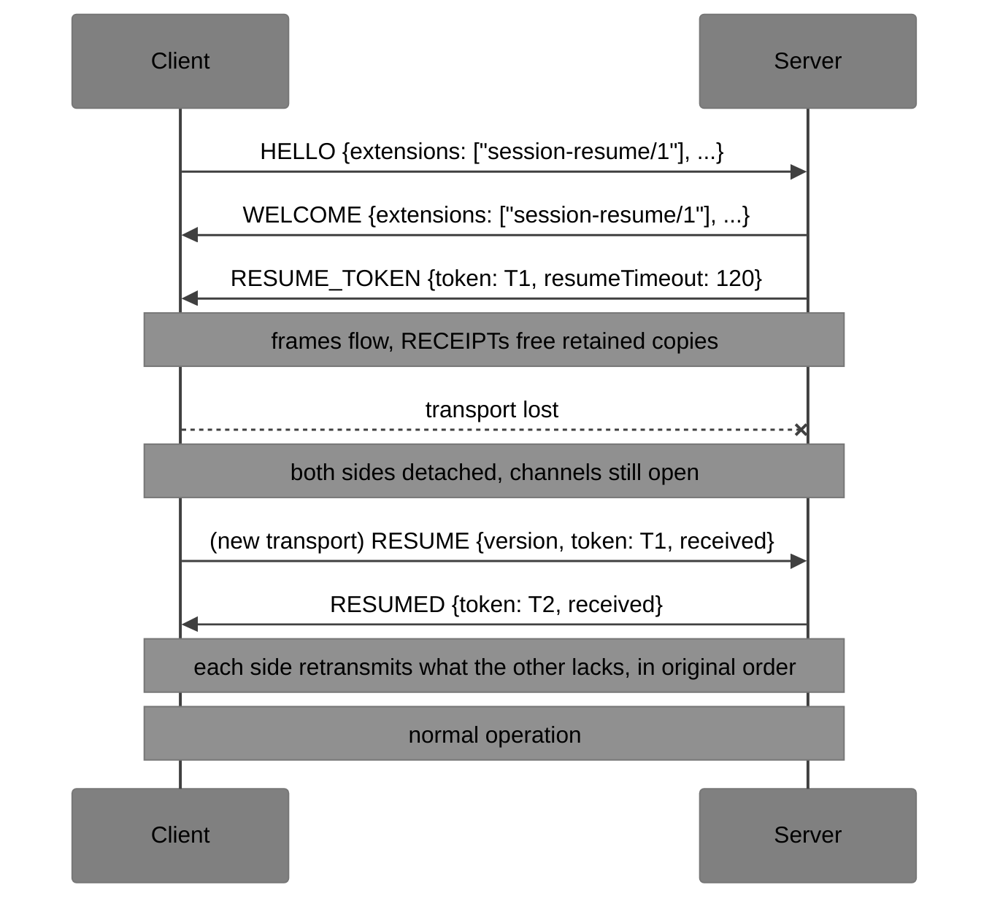

# xumux Extension: Session Resume

**Status**: Draft | **Extension**: `session-resume/1` | **Core**: [0.3](../core.md)

This extension replaces the 0.1-era text, which carried sequence numbers in DATA payloads and a header byte that later versions no longer have. The choices behind it are recorded in [Design decisions](#design-decisions).

Session Resume lets a client reconnect after the transport fails and continue the **same** xumux connection: the same channels, the same flow-control state, and no lost or duplicated messages on reliable, ordered channels. It covers short outages (Wi-Fi to cellular, sleep and wake, a proxy restart). Keeping work alive with no client for hours, scrollback, and attaching several clients are application concerns ([docs/apps/session-persistence.md](../../docs/apps/session-persistence.md)) and are out of scope.

## 1. Design in brief

- Nothing changes on the wire for application frames. There are **no sequence numbers in frames**. Each side counts the frames it sends and receives on every replayed channel, and frames on one channel arrive in order on one transport, so a count is enough to say what arrived.
- Each side keeps a copy of every replayed frame it has sent until the peer acknowledges it with a RECEIPT. A receiver acknowledges frames before it returns their credit, so the retained data on a channel never exceeds that channel's flow-control window. The memory bound of [core §6](../core.md#6-flow-control) therefore also bounds the resume buffer.
- After a resume, each side retransmits exactly what the peer has not received, in the original order. Frames are neither lost nor sent twice, so channel state, fragment reassembly and flow-control credit carry over unchanged. Credit is **not** re-synchronised, because nothing that affected it is lost.
- The client resumes by sending RESUME instead of HELLO on a new transport, presenting a single-use token. Each successful resume issues a new token.

**Hooks used** ([core §11.1](../core.md#111-extensions)): control types `0x30`–`0x33`; keeping the connection alive when its base path is lost and replacing the base path under it; another first frame on a new transport (RESUME, [core §3.1](../core.md#31-rules)); codes `4100`–`4103`. The extension defines no `extensionParams` ([core §3.8](../core.md#38-extension-parameters)).

## 2. Negotiation

The client lists `session-resume/1` in HELLO `extensions`, and the extension applies only if WELCOME includes it. When it applies, the server's first frame after WELCOME MUST be RESUME_TOKEN.

## 3. Control messages

All are on channel 0, with control types allocated in the [registry](../registry.md).

| Type | Name | Direction | Payload | Replayed |
|---|---|---|---|---|
| `0x30` | RESUME_TOKEN | S→C | JSON | yes |
| `0x31` | RESUME | C→S | JSON, first frame on a new transport | no |
| `0x32` | RESUMED | S→C | JSON, answer to RESUME | no |
| `0x33` | RECEIPT | both | binary | no |

### 3.1 RESUME_TOKEN (`0x30`), server → client

```json
{ "token": "pV1x3c0Jx2m5Q8yJmI2nqQ", "resumeTimeout": 120 }
```

| Field | Type | Req. | Description |
|---|---|---|---|
| `token` | string | MUST | Opaque secret with at least 128 bits of entropy, at most 512 bytes. |
| `resumeTimeout` | number | MUST | Seconds the server keeps the session after losing the transport. MUST be between 1 and 3600. |

The server MAY send a new RESUME_TOKEN at any time to rotate the token. The most recently received token replaces all earlier ones, and the server MUST stop accepting a token once it has sent its replacement and the replacement has been acknowledged (by a RECEIPT covering it).

### 3.2 RESUME (`0x31`), client → server

Sent as the first frame on a new transport, in place of HELLO, after the magic bytes on stream bindings. This is the extension-defined first frame of [core §3.1](../core.md#31-rules), and RESUMED (or CLOSE) is its answer.

```json
{
  "version": [0, 3, 0],
  "token": "pV1x3c0Jx2m5Q8yJmI2nqQ",
  "received": [[0, 41], [1, 1093], [3, 0]],
  "auth": { "type": "token", "token": "eyJhbGciOi..." }
}
```

| Field | Type | Req. | Description |
|---|---|---|---|
| `version` | `[major, minor, patch]` | MUST | MUST be compatible with the session's version ([core §3.5](../core.md#35-version-negotiation)). |
| `token` | string | MUST | The latest token from RESUME_TOKEN or RESUMED. |
| `received` | `[id, count][]` | MUST | The client's receive counts ([§4](#4-counting)). |
| `auth` | object | MAY | Credentials, as in HELLO. |

### 3.3 RESUMED (`0x32`), server → client

```json
{ "token": "h3Zt9QmR0aLk7wUe5bS1fA", "resumeTimeout": 120, "received": [[0, 57], [1, 12]] }
```

| Field | Type | Req. | Description |
|---|---|---|---|
| `token` | string | MUST | A new token. It replaces the one in RESUME once the client confirms it (below). |
| `resumeTimeout` | number | MUST | As in RESUME_TOKEN. |
| `received` | `[id, count][]` | MUST | The server's receive counts. |

The limits, keepalive parameters, extensions and `application` of the session do not change on resume.

**Confirming the new token.** RESUMED is not replayed, so if the new transport fails before RESUMED arrives, the client still has only the old token. The client MUST therefore send a RECEIPT for channel 0 as its first frame after RESUMED. Until the server receives any frame from the client on the transport that carried RESUMED, it MUST accept both the old token and the new one. After that, it accepts only the new one. A successful resume with either token invalidates the other.

**Token order after a resume.** Which token is current follows the order in which the client *receives* tokens, not the order the server made them. A RESUME_TOKEN not covered by the client's RESUME `received` counts is retransmitted after RESUMED ([§7](#7-resuming) step 5), so it arrives after RESUMED's token and replaces it at the client. The server MUST therefore keep such a retransmitted token valid, and retires RESUMED's token by the [§3.1](#31-resume_token-0x30-server--client) rule, once the retransmitted RESUME_TOKEN is acknowledged.

### 3.4 RECEIPT (`0x33`)

Binary payload of one or more 6-byte entries, the same shape as WINDOW_UPDATE:

```
[Channel:2][Count:4] [Channel:2][Count:4] ...
```

Each entry says "I have received `Count` replayed frames on this channel". A payload length that is not a positive multiple of 6 MUST cause CLOSE `4001`. An entry with a count higher than the receiver has sent on that channel MUST cause CLOSE `4103`. Entries for channels that are not replayed, closing or unknown MUST be ignored. A count lower than one already received is stale and MUST be ignored.

## 4. Counting

**Replayed frames** are the non-probe frames sent:

- on channel 0 after the handshake (WELCOME), except RECEIPT, RESUME and RESUMED;
- on a channel that uses the base path ([core §1.2](../core.md#12-layers)) and whose effective properties are both `reliable` and `ordered`.

Probe frames are never replayed or counted. Neither are frames on other channels. A channel whose frames are replayed is a **replayed channel**.

Each side keeps, for every replayed channel and each direction, the number of replayed frames sent and received. The count of channel 0 starts at 0 after WELCOME. The count of any other channel starts at 0 when that channel comes into existence on that side (Opening), so a reused ID starts again from 0. Counts are unsigned 32-bit values that wrap, and are compared with serial-number arithmetic (RFC 1982). A sender MUST NOT have 2³¹ or more unacknowledged frames on one channel.

Fragments are counted individually, so a transport can fail in the middle of a fragmented message. The receiver keeps its partial reassembly, and the retransmitted fragments complete it.

## 5. Acknowledging and retaining

- A sender MUST retain a copy of each replayed frame it has sent until a RECEIPT (or a RESUME / RESUMED `received` list) covers it.
- **Receipt before credit.** A receiver MUST NOT send a WINDOW_UPDATE that returns credit for bytes of a frame unless it has already sent a RECEIPT covering that frame. RECEIPT and WINDOW_UPDATE both travel on channel 0, so the RECEIPT arrives first. Because the sender cannot have more unacknowledged bytes on a channel than the credit it was granted, the retained **payload** bytes per channel are at most that channel's window.
- **Frame limit.** Credit does not count headers, and empty frames take none, so the window alone does not bound retained frames. A sender MUST also limit the unacknowledged frames per channel. The limit MUST be at least 128 (4096 recommended). At that limit it stops sending on the channel and waits for a RECEIPT. Receivers SHOULD send a RECEIPT whenever 64 frames on any replayed channel are unacknowledged. Retained storage per channel is then at most the window plus the frame limit × (8 bytes + per-frame overhead).
- **Channel 0.** A receiver SHOULD send a RECEIPT for channel 0 whenever 32 KiB or 64 frames are unacknowledged, and MUST NOT withhold it indefinitely: whenever frames are unacknowledged and none are waiting to be processed, it MUST send a RECEIPT promptly. A sender whose unacknowledged channel-0 data exceeds a local limit (1 MiB recommended) MAY close with `4004`.
- **Every replayed channel.** The same prompt rule applies to every replayed channel, whether or not its frames carry credit to return, and including a channel with an unfinished fragmented message: whenever frames are unacknowledged and none are waiting to be processed, the receiver MUST send a RECEIPT promptly. So a sender stopped at its frame limit is always released.
- **Dropping.** A side MAY discard retained frames for a channel once it has received the peer's CLOSE_CHANNEL for it. The peer discards frames for a channel it has closed ([core §5.4](../core.md#54-closing-a-channel)), so they will never be needed. See [§7](#7-resuming) for the other cases where retained frames are dropped on resume.

## 6. Losing the transport

When `session-resume/1` applies, a transport that ends **without** a completed CLOSE exchange does not close the connection. Each side instead **detaches** the session:

- The session, its channels and their state stay as they are. Application sends on reliable channels queue as usual until credit runs out, so the existing backpressure applies. Messages sent on unreliable channels while detached MAY be dropped.
- Keepalive is suspended. PINGs that were outstanding are abandoned and SHOULD NOT be counted as lost.
- A keepalive timeout ([core §8.2](../core.md#82-keepalive)) detaches the session instead of closing it. The side MUST close the transport and MUST NOT send CLOSE `4008`, since that would end the session.
- The server keeps the detached session for at least `resumeTimeout` seconds, then discards it. The client SHOULD stop trying to resume after `resumeTimeout` seconds. It then ends the session locally and reports it to the application as `4101` (RESUME_EXPIRED), the code the server would send.
- A server that receives a valid RESUME for a session that still appears attached MUST treat it as a takeover: it stops reading the old transport, closes it without sending CLOSE, and then answers on the new one. The client often learns of a failure before the server does.

Sending or receiving CLOSE ends the session for good. It can no longer be resumed, and a side that loses the transport during a CLOSE exchange discards the session.

## 7. Resuming



1. The client opens a new transport with the same binding and sends RESUME as its first frame. The HELLO rules apply to it: the server's HELLO timeout covers it ([core §3.1](../core.md#31-rules)), and the client sends nothing else until it receives RESUMED or CLOSE.
2. The server checks, in order: the version (CLOSE `4006`), the token (CLOSE `4100`, or `4101` for a token it knows has expired), authentication (CLOSE `4000`, [§8](#8-security)), and the `received` counts (CLOSE `4103` if a count exceeds what it sent, `4102` if it no longer holds a frame the client needs). Rejection follows [core §3.7](../core.md#37-rejection). A rejected RESUME does not end the detached session unless the server decides so, except that `4102` and `4103` end it.
3. On success the server takes over the session ([§6](#6-losing-the-transport)) and sends RESUMED with its own receive counts.
4. The client checks the server's counts the same way and sends CLOSE `4103` or `4102` if they are inconsistent.
5. Each side then retransmits, before any new frame (except the client's confirming RECEIPT, [§3.3](#33-resumed-0x32-server--client), which comes first), every retained frame the peer has not received, in the order the frames were first sent. Retransmitted frames do not consume credit again: it was taken when they were first sent.

**Which channels are listed.** A `received` list has an entry for channel 0 and for every replayed channel that the reporter has in Opening or Open state. It has no entry for channels that are closing or closed. An entry refers to the channel instance the *reporter* has, which after an ID reuse can be a later instance than the one the receiver of the list still holds. For each channel instance with retained frames, the sender therefore decides in this order:

1. If it has received the peer's CLOSE_CHANNEL for this instance, it discards them.
2. If it has sent CLOSE_CHANNEL for this instance, and the peer's channel-0 count shows that the peer received it, it discards them. The peer has processed the close, so an entry for that ID can only be a later instance.
3. Otherwise, if the peer listed the ID, the entry is for this instance, and the sender retransmits from the listed count.
4. Otherwise it discards them. The peer has closed the channel or has never heard of it. In the second case the only retained frames are on channel 0 (the OPEN_CHANNEL), and those are replayed.

Case 3 is safe. The peer has seen no close of this instance in either direction, because a close it had sent would make it omit the entry, and so it cannot have reused the ID: an opener reuses an ID only after it has both sent and received CLOSE_CHANNEL. For example, suppose the server sends data on channel 5 and then CLOSE_CHANNEL. The client receives both, replies with CLOSE_CHANNEL, and reopens 5, but its reply and the OPEN_CHANNEL are lost with the transport. The client lists the new 5 with count 0. The server's retained data for the old 5 is discarded by rule 2, because the client's channel-0 count covers the server's CLOSE_CHANNEL. The client's replayed reply and OPEN_CHANNEL then arrive in order.

Retransmitting in the original order keeps the cross-channel order a single-stream binding gives (for example, a channel's last data before its CLOSE_CHANNEL).

**Unreliable channels** on the base path stay open. Their frames are not retained, and those lost with the transport are lost.

**Channels on their own path** (with [webrtc-multichannel](webrtc-multichannel.md), for example) lost that path with the transport. That includes every reliable, unordered channel, since the base path is ordered. On resume, each side MUST close every such channel with CLOSE_CHANNEL `1001` after its retransmissions. A channel it still has in Opening state it closes once CHANNEL_ACK arrives. A request for such a channel that it has received but not yet answered, it rejects with `1001`. Re-creating such paths on resume is not part of `/1`. On a binding with only a base path no channel is on its own path, so this rule applies only with an extension that adds paths.

**RESUME too large.** RESUME and RESUMED, like every channel-0 payload, MUST NOT exceed 65536 bytes ([core §4](../core.md#4-control-messages)). A client whose RESUME would not fit MUST NOT send it. It treats the session as lost and falls back to HELLO. A server whose RESUMED would not fit closes with `4102`.

**After resuming**, RTT smoothing ([core §8.1](../core.md#81-ping-0x10-and-pong-0x11)) SHOULD start again from fresh samples, because the path has probably changed. Keepalive restarts.

## 8. Security

- The token is a bearer secret. It MUST be generated by a CSPRNG, MUST be compared in constant time, and MUST NOT be logged. Clients MUST keep it in memory only.
- RESUME_TOKEN, RESUMED and RESUME MUST NOT be sent over a transport that is not encrypted, except on local bindings (stdio, Unix sockets), the same rule as for HELLO `auth`.
- **Single use.** A token is valid for one successful resume. RESUMED always carries a new one, and the old one stays valid only until the client confirms it ([§3.3](#33-resumed-0x32-server--client)). A captured token is therefore useless once the real client has resumed, and if an attacker resumes first, the real client's RESUME fails visibly with `4100`.
- **Binding to the original session.** If the server authenticated the client in HELLO (by `auth` or by the transport, such as a cookie or a client certificate), it MUST authenticate RESUME by the same means, and MUST reject it with `4000` unless the identity is the same as the original session's. A token alone does not let one identity take over another's session.
- **Replay.** RESUME MUST NOT be sent in TLS or QUIC 0-RTT early data. Early data can be replayed, and a replayed RESUME would take over the session.
- **Resource limits.** A detached session holds at most its flow-control windows, its per-channel frame limits ([§5](#5-acknowledging-and-retaining)) and its channel-0 retention. Servers SHOULD also cap the number of detached sessions per identity and in total, and MAY discard detached sessions early under memory pressure (resumes then fail with `4100`). Servers SHOULD rate-limit failed RESUMEs per source.

## 9. Codes

| Code | Name | Meaning |
|---|---|---|
| 4100 | RESUME_NOT_FOUND | Unknown or invalid token, or the session is gone |
| 4101 | RESUME_EXPIRED | The session existed but was discarded after `resumeTimeout` |
| 4102 | RESUME_DATA_LOST | A frame needed for the resume is no longer retained |
| 4103 | RESUME_STATE_MISMATCH | Receive counts that cannot be right (more than was sent) |

A client that receives any of these on RESUME SHOULD fall back to a new HELLO and tell the application that the earlier session is lost. The same applies to CLOSE `1002` from a server that no longer implements the extension ([core §3.1](../core.md#31-rules)), and to `4006` from a server that no longer speaks the session's version.

**Other refusals.** CLOSE `1001` (GOING_AWAY), `4004` (RATE_LIMITED), `4007` (HELLO_TIMEOUT) and `4011` (BUSY) on RESUME say nothing about the session, which the server keeps ([§7](#7-resuming) step 2). A client that receives one MAY try again on another new transport, with backoff, until `resumeTimeout` has passed. Any other code, including `4000`, ends the session at the client: it tells the application that the session is lost and does not resume it again.

## 10. Implementation notes

- The extension sits at layers 2–3 ([core §1.2](../core.md#12-layers)): it replaces the base path under a live session, so to the core a resumed connection looks like one unbroken frame stream. It does need to know which channels are open, their paths and their effective properties, so it is not a pure path wrapper.
- A retained frame can share the buffer that was sent. Retention adds no copy if the sender does not reuse that buffer until the RECEIPT.
- Implementations need a way to swap the base path under a live session. Neither 0.2 implementation (Go [libxumux-go](https://github.com/deftai/libxumux-go), TypeScript [libxumux](https://github.com/deftai/libxumux)) lets a session outlive its transport.
- **Load-balanced servers.** A RESUME can reach a different server process than the one holding the session. The token is opaque, so a deployment can encode a routing hint in it. Routing is left to deployments.

## Design decisions

These were open in the design draft and are settled for `/1`:

1. **Implicit counts, not sequence numbers.** Frames carry nothing extra. Counting works because every replayed channel is ordered on the base path, and a bridge forwards frames unchanged.
2. **Multi-path bindings.** Only reliable, ordered channels on the base path are resumed. Channels on their own path are closed with `1001` on resume ([§7](#7-resuming)). Re-creating per-channel paths (new DataChannels and SDP, or new QUIC streams) is left to a later version, specified with each multi-path binding.
3. **JSON `received` lists.** At about 15 bytes per channel, a RESUME fits about 4000 open channels. A RESUME that would not fit is not sent, and the client falls back to HELLO ([§7](#7-resuming)). A binary encoding can come later if large channel counts become real.
4. **Bearer token.** A single-use token plus re-authentication ([§8](#8-security)) works through any bridge. Binding the token to TLS (an RFC 9266 exporter) or a challenge would need a round trip or an exporter that browsers do not expose.
5. **`resumeTimeout` is server-declared only.** A client cannot make a server hold memory longer. Both sides retain and replay their own frames.
6. **Load balancing** is left to deployments ([§10](#10-implementation-notes)).
7. **No abandon message in `/1`.** A client that gives up cannot free the detached session before `resumeTimeout`. A `RESUME` with `"abandon": true`, answered by CLOSE `1000`, can be added if servers report memory pressure from detached sessions.
8. **First frame.** Core 0.3 lets an extension define another first frame on a new transport ([core §3.1](../core.md#31-rules)), so a server that does not implement this extension closes a RESUME with `1002`.

## Open questions

1. **RECEIPT frequency defaults.** The values in [§5](#5-acknowledging-and-retaining) (64 frames on any replayed channel; 32 KiB or 64 frames on channel 0) are SHOULDs and do not affect interoperability, but they have not been measured on real traffic, especially terminal traffic, which is many small messages. They may be retuned in a later revision.
